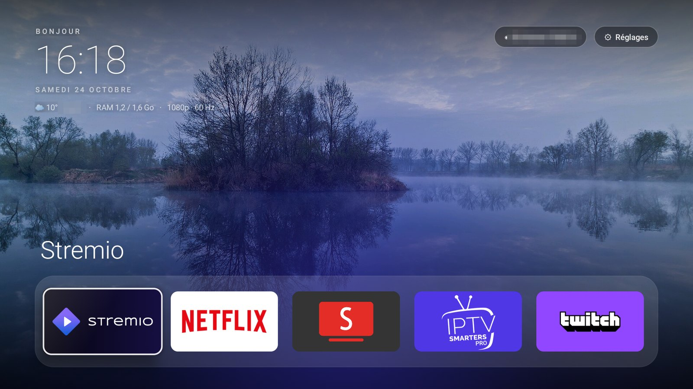
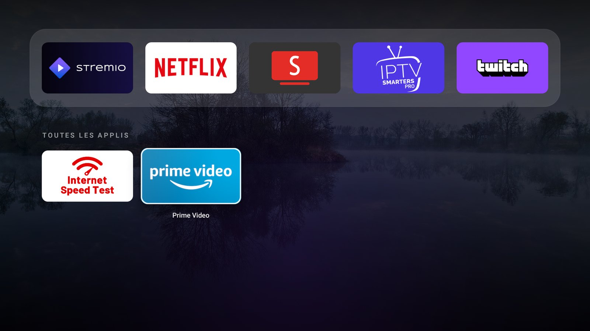
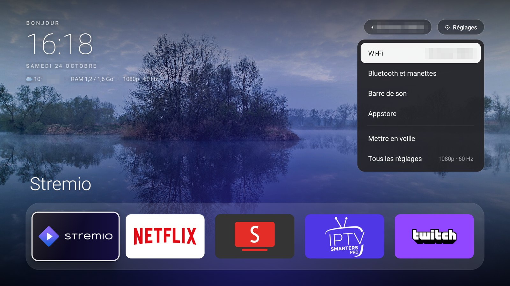
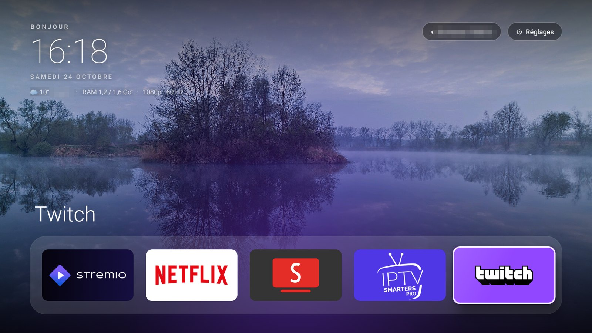

# firetv-home

**Un Fire TV rapide, propre et sans pubs.** Un écran d'accueil minimaliste avec de beaux fonds
d'écran, le nettoyage des applis Amazon inutiles, un DNS anti-pub, le tout installé depuis un PC en
une commande et entièrement réversible.



## Ce que ça fait

- **Un écran d'accueil à la place de celui d'Amazon** : horloge, météo, RAM et mode d'affichage, un
  dock de tes applis préférées avec une lueur de la couleur de l'appli sélectionnée, toutes les
  autres applis en grille, et 12 photos de nature qui changent toutes les 10 minutes. Zéro pub, zéro
  recommandation. Environ 70 Mo de RAM, contre 100 à 140 Mo pour l'accueil Amazon.
- **Le bouton Home ramène sur cet accueil**, en environ 20 ms, y compris au démarrage et depuis
  l'Appstore.
- **Le bouton YouTube de la télécommande ouvre SmartTube** (ou l'appli de ton choix), alors que
  Fire OS refuse normalement toute appli YouTube qui ne vient pas d'Amazon.
- **Un panneau Réglages rapide** (bouton Menu de la télécommande) : Wi-Fi, Bluetooth et manettes,
  barre de son, Appstore, mise en veille, tous les réglages.
- **Nettoyage** : désactive (sans jamais désinstaller) la télémétrie, les pubs et les applis Amazon
  superflues (shopping, miniTV, GameHub, Photos, Musique, mode Ambient) et, au choix, Alexa.
- **DNS anti-pub** : AdGuard DNS chiffré, qui bloque pubs et traqueurs dans toutes les applis.
- **Animations accélérées** (0,5x) pour une interface plus vive.

| | |
|---|---|
|  |  |
|  |  |

## Installation

### 1. Sur le Fire TV

1. **Paramètres → Mon Fire TV → À propos** : clique 7 fois sur le nom de l'appareil pour activer
   les options pour les développeurs.
2. **Paramètres → Mon Fire TV → Options pour les développeurs** : active **Débogage ADB**.
3. **Paramètres → Mon Fire TV → À propos → Réseau** : note l'**adresse IP**.

### 2. Sur le PC (Windows, macOS ou Linux)

Il faut [Git Bash](https://git-scm.com/) sous Windows, `adb`, et pour compiler le launcher un JDK
17 et le SDK Android (sans Android Studio). Sous Windows :

```bash
winget install Google.PlatformTools
winget install Microsoft.OpenJDK.17
```

Le SDK Android : télécharge les [command-line tools](https://developer.android.com/studio#command-tools),
puis :

```bash
sdkmanager --sdk_root="$HOME/android-sdk" "build-tools;34.0.0" "platforms;android-30"
```

et indique-le au script de compilation dans `launcher/local.env` (ignoré par git) :

```bash
ANDROID_HOME="$HOME/android-sdk"
```

### 3. Lancer l'installation

```bash
./setup.sh 192.168.1.42
```

Au premier lancement, accepte **« Autoriser le débogage USB ? »** sur la télé (coche « Toujours
autoriser »). Le script compile le launcher, l'installe, applique le nettoyage, les animations et le
DNS, puis vérifie que tout tourne. On peut le relancer sans risque, par exemple **après une mise à
jour de Fire OS**, qui peut réactiver des applis Amazon.

Options utiles :

```bash
./setup.sh 192.168.1.42 --keep alexa          # garder Alexa (micro de la télécommande)
./setup.sh 192.168.1.42 --skip-dns            # pas de DNS anti-pub
./setup.sh 192.168.1.42 --dns dns.nextdns.io  # un autre DNS
./setup.sh 192.168.1.42 --rebuild             # recompiler après avoir modifié le launcher
```

### Tout annuler

```bash
./uninstall.sh 192.168.1.42
```

Rend l'accueil Amazon, réactive toutes les applis, remet les animations et le DNS par défaut. Les
mêmes options `--skip-…` et `--keep` permettent de n'annuler qu'une partie.

## Personnaliser

| Quoi | Où |
|---|---|
| Applis du dock, applis masquées, appli du bouton YouTube | [`launcher/res/values/config.xml`](launcher/res/values/config.xml) |
| Fonds d'écran (JPEG 1920×1080) | `launcher/assets/wallpapers/` |
| Paquets désactivés | [`debloat/`](debloat/), une liste par thème |

Après une modification du launcher : `./setup.sh <ip> --rebuild --skip-debloat --skip-tweaks --skip-dns`.

## Comment ça marche, et les limites de Fire OS

Amazon verrouille beaucoup de choses sur Fire OS 8. Voici ce qu'on a découvert et comment le projet
s'en accommode :

- **Le bouton Home appartient à Amazon.** Une appli ne peut pas devenir l'écran d'accueil par
  défaut, et Fire OS empêche même les services d'accessibilité d'intercepter la touche. Le launcher
  lit donc le journal système (permission `READ_LOGS`, accordée par `setup.sh`) : quand le système
  ouvre l'accueil Amazon, il le remplace aussitôt. L'accueil Amazon peut apparaître une fraction de
  seconde.
- **Le bouton YouTube n'ouvre que des applis signées par Amazon.** Fire OS écrit « App youtube is
  not trusted » dans le journal et abandonne. Le launcher repère cette ligne et ouvre SmartTube à
  la place. L'écran noir de quelques secondes vient de Fire OS, qui rallume l'entrée HDMI de la télé
  (HDMI-CEC).
- **L'Appstore fait partie de l'accueil Amazon** sur Fire OS 8 : il passe donc par l'accueil Amazon.
- **« Affichage et sons » est interdit aux applis tierces** ; le panneau propose la barre de son et
  tous les réglages à la place.
- **Quelques services ne s'arrêtent pas** sans root, même désactivés (`telemetry.emitter`, `whad`) :
  le DNS anti-pub bloque au moins leurs envois.
- **Une appli ne peut pas en décharger une autre de la mémoire**, ni se connecter à l'ADB interne de
  la télé. Fire OS gère donc lui-même la mémoire, ce qu'il fait bien.

## Vie privée

Le launcher ne fait que deux appels réseau, pour la météo : [ipapi.co](https://ipapi.co) pour
trouver ta ville à partir de ton IP (une fois par jour) et [Open-Meteo](https://open-meteo.com)
pour la température (au plus toutes les 30 minutes, seulement quand l'accueil est affiché).
Aucun compte, aucune pub, aucune statistique.

## Testé sur

| Appareil | Fire OS |
|---|---|
| Fire TV Stick 4K Max (2e génération, AFTKRT) | 8.1.8.5 |

Les listes de [`debloat/`](debloat/) ont été établies sur ce modèle. Sur un autre Fire TV, un paquet
absent est simplement ignoré.

## Crédits

- Basé sur [tv-home](https://github.com/mihirgupta0900/tv-home) de Mihir Gupta (MIT), adapté pour
  Fire OS.
- Fonds d'écran : Wikimedia Commons, licences CC, voir
  [`launcher/WALLPAPER-CREDITS.md`](launcher/WALLPAPER-CREDITS.md).
- Météo : [Open-Meteo](https://open-meteo.com). DNS : [AdGuard DNS](https://adguard-dns.io).

Licence MIT, voir [LICENSE](LICENSE).
